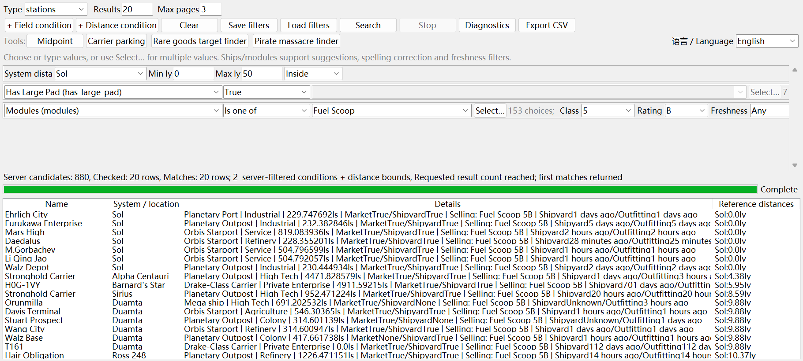
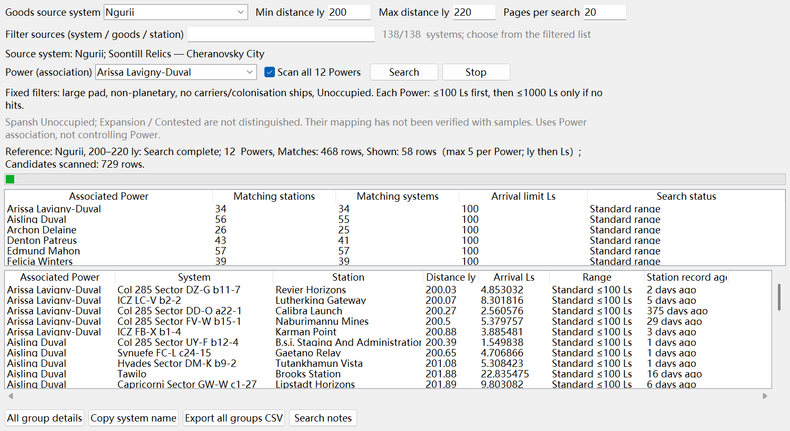
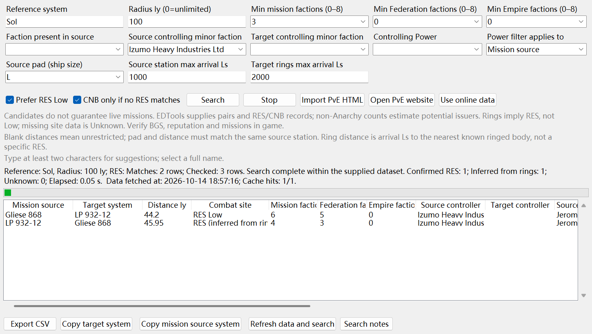
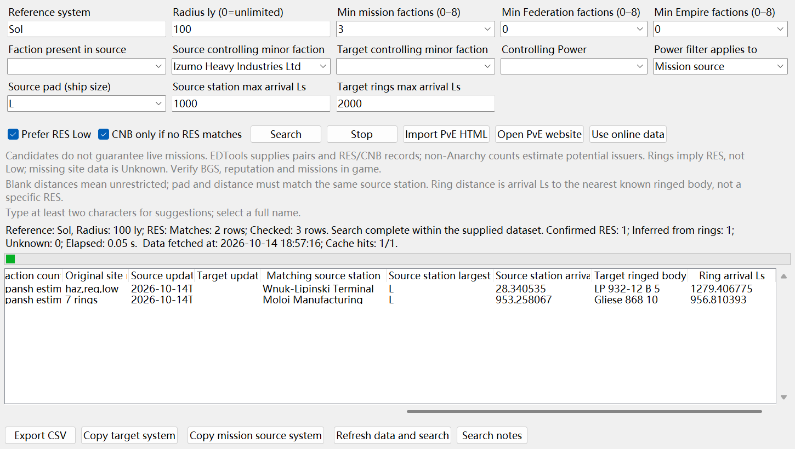
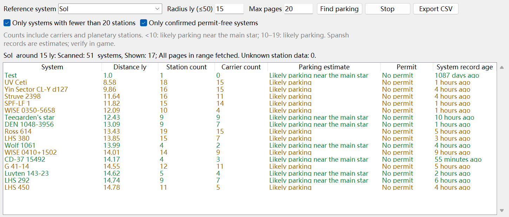
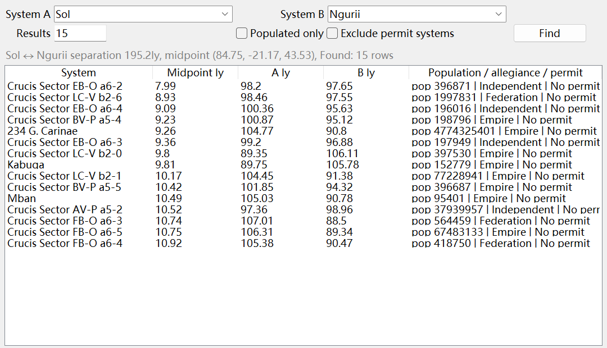

# Elite_dangerous_Filter

[English](README.md) · [简体中文](README_zh-CN.md) · [Releases](https://github.com/kxdxzr/Elite_dangerous_Filter/releases)

An Elite Dangerous system and station filtering desktop tool powered by [Spansh](https://spansh.co.uk/), built with Python / tkinter and an instantly switchable Chinese / English UI.

**Positioning: it may not be more convenient than Inara, but offers broader, more flexible, freely combinable filters.** It complements common lookups with more complex queries.

Repository: [kxdxzr/Elite_dangerous_Filter](https://github.com/kxdxzr/Elite_dangerous_Filter). Developed by **GPT-6.1 Sol** through **vibe coding**, with ongoing user-driven iteration.

> **v0.1.1: the pirate massacre finder is still being tested.** It returns candidate source/target pairs, not guaranteed live missions, issuer counts or RES availability. Inferred ring-based RES and explicit site records are labelled separately. Verify results in game.

## Download and run

[**Download Windows EXE**](https://github.com/kxdxzr/Elite_dangerous_Filter/releases/download/v0.1.1/EliteDangerousFilter.exe) · [v0.1.1 release notes](docs/releases/v0.1.1.md) · [All releases](https://github.com/kxdxzr/Elite_dangerous_Filter/releases)

Run `EliteDangerousFilter.exe` on 64-bit Windows; no Python installation is needed. Searches require an internet connection, but no API key.

For source execution, use **Python 3.10+ with tkinter**; there are no third-party runtime dependencies:

```sh
git clone https://github.com/kxdxzr/Elite_dangerous_Filter.git
cd Elite_dangerous_Filter
python filter_gui.py
```

Check Tk with `python -m tkinter`. Debian / Ubuntu may require `sudo apt install python3-tk` first.

Select **中文 / English** on the main window to switch all tool windows immediately. System, faction, ship and module names remain unchanged; switching language preserves raw query conditions.

## Features

- **General filters:** systems/stations, repeated conditions, OR within a multi-select row and AND between rows.
- **Distances and modules:** multiple reference points, distance intersections/outside ranges, same-item module class/rating matching, and shipyard/outfitting freshness filters.
- **Carrier parking estimates:** up to 50 ly; station totals include carriers. Fewer than 10 suggests likely parking near the main star, 10–19 suggests likely parking. This is not a live vacancy API.
- **Rare goods target finder:** 142 source entries across 138 systems, default Ngurii and a 200–220 ly target range. Select an associated Power or scan all 12. Requires large pads; excludes planetary stations, carriers and colonisation ships. Each Power starts at ≤100 Ls and expands to ≤1000 Ls only after a complete search finds no matches. Shows up to five targets per Power, ordered by ly then Ls.
- **Pirate massacre candidates (testing):** EDTools source/target pairs and site records, with Spansh faction, issuer-count, controlling Power, source-station and target-ring filters.
- **Utilities:** system midpoint, cancellation, diagnostics, CSV export, condition files and session restoration for the main window and all four tools.

## Pirate massacre finder (testing)

Open **Extra tools → Pirate massacre finder**. All enabled filters are AND:

| Filter | Meaning |
| --- | --- |
| Reference / radius ly | Distance from **mission source to reference**, not source to target; `0` is unlimited, but the reference still controls sorting |
| Minimum total / Federation / Empire factions | Independent minima, each `0–8`; `0` disables that constraint; enabled counts estimate non-Anarchy potential issuers from Spansh |
| Faction present in source | Requires presence, not control |
| Source / target controlling minor faction | Exact full-name, case-insensitive matching; suggestions never automatically rewrite input |
| Controlling Power | Uses `controlling_power`, not associated `power`; applies to source, target or both |
| Source pad | Blank means unrestricted; S/M/L is the ship-size requirement, with larger pads accepting smaller ships |
| Source station max arrival Ls | Blank means unrestricted; **the same station with Missions service** must satisfy pad and distance. Includes planetary stations; excludes carriers, Stronghold Carriers and colonisation ships |
| Target rings max arrival Ls | Blank means unrestricted; arrival distance of the nearest known ringed body, not ring radius or a specific RES location |
| Prefer RES Low | Explicit Low sites sort first; Low is optional and is never inferred from rings |
| CNB fallback | Only after a complete search finds no matching explicit/inferred RES and no unknown-site candidates; disabled on errors or cancellation |

**Distance distinction:** radius `0` is unlimited; station/ring distances are unlimited only when blank. Entering `0` sets an actual **0 Ls** maximum. Maximum bounds are inclusive.

- Rings are labelled **RES (inferred from rings)**; missing site data is **Unknown**, not proof of no RES. When an explicit distance constraint is enabled, unknown distances do not qualify and produce unknown/incomplete diagnostics.
- Radii ≤250 ly use EDTools' explicit `/pve.php` page; `0` or >250 ly use public `pve.json` and `res.json`, with coordinate-based distances. Completeness means the supplied catalogue, not the whole galaxy. Reference, coverage, schema and row counts are validated.
- **Import PvE HTML** accepts browser-saved pages and rejects insufficient coverage. Imported site/radius-only queries can run offline when the reference name matches; other filters contact Spansh as needed.
- **Copy mission source system** and **Copy target system** copy the selected row; double-click still copies the target. Matching station and ringed-body details are included in the table and CSV.
- Controller/Power filters are batched and their detail records reused; Power uses gzip and at most four concurrent pages. Ring distances come from batched full-body records, not summaries that omit rings. Throttled progress and 200-row rendering batches preserve the full query/export results.
- EDTools cache TTL is one hour; Spansh details/controller lists/ring distances use five minutes. **Refresh data and search** switches to online data and forces refresh, without silently substituting expired data on failure. Target Power combined with source constraints may still require additional source detail lookups.

Measured locally for `Sol / unlimited / minimum 3 factions / Yuri Grom / source`: about 15.37 seconds for forced refresh and 0.19 seconds for the immediately repeated cached search, with identical results. Network conditions and changing data affect timings. Detailed rules and examples are in the [Chinese search-logic document](README_检索逻辑.md).

## Sessions, data and limitations

- Changes auto-save every 1.5 seconds and on window close. Old sessions remain compatible; incomplete main-condition drafts, language and all four tool settings are preserved. Writes are atomic; failed close-time saves display an error and keep the window open.
- EXE data lives in `%LOCALAPPDATA%\EliteDangerousFilter\`; source execution defaults to the project directory. Override with `ELITE_FILTER_DATA_DIR`. Personal sessions, field/module caches, `pve_cache_*.json` and CSV exports are excluded from Git.
- Third-party records are not live missions, stock or vacancies. Faction counts only estimate potential issuers; verify BGS state, reputation and mission availability in game.
- Rare goods searches use associated Power. Spansh `Unoccupied` currently approximates Inara's Unoccupied / Expansion / Contested group; that mapping is unverified and the latter two cannot be filtered separately.
- Server counts may be capped. Page limits, repeated pages, missing required fields, request failures and cancellation distinguish incomplete searches from confirmed empty results.

## Development and verification

```sh
python -m unittest discover -v
python -m compileall -q .
python -m pip install -r requirements-build.txt
python -m PyInstaller --noconfirm --clean EliteDangerousFilter.spec
```

145 tests cover the engine, sessions, localization, PvE conditions/data integrity/cache/concurrency and real GUI interactions. Tk tests require a graphical display and are skipped on headless Linux. GitHub Actions tests Windows / Ubuntu with Python 3.10 / 3.13.

Build output: `dist/EliteDangerousFilter.exe`. Use `--smoke-test <report.json>` to verify four tool windows and both languages. Run `--session-test write <report.json>` and `--session-test read <another-report.json>` in separate processes to verify restoration. Session tests require an isolated `ELITE_FILTER_DATA_DIR`; report directories must already exist.

CLI entry point: `python spansh_filter.py --help`. Main modules: `filter_gui.py` / `filter_engine.py`, `powerplay_gui.py` / `powerplay_tool.py`, `pve_gui.py` / `pve_tool.py`, `pve_access.py` / `pve_cache.py`, `i18n.py` / `localized_tk.py` and `faction_options.py`.

## Screenshots

These English-interface screenshots cover the main window and all four tools. They show real GUI queries captured on 2026-10-14; results change with upstream data. For Chinese-interface screenshots, see the [Chinese README](README_zh-CN.md#截图).

### Main window



### Rare goods target finder



### Pirate massacre finder — filters and results (testing)

Source faction, issuer count, landing pad and station/ring distance filters, RES Low priority, and separate source/target copy buttons.



### Pirate massacre finder — English UI and distance details (testing)

The same query after switching to English. The table is scrolled right to show the matching source station, pad, station arrival distance and target ringed body/distance; columns were widened for readability.



### Carrier parking finder

Sol within 15 ly, with station/carrier counts and parking estimates. These are recorded-data estimates, not live vacancies.



### System midpoint finder

Nearest recorded systems to the Sol–Ngurii midpoint, with distance to the midpoint and both endpoints.



## Data sources

- [Spansh](https://spansh.co.uk/): systems, stations, factions and full body data.
- [EDSM](https://www.edsm.net/): reference-system coordinates.
- [EDTools / CMDR VicTic](https://edtools.cc/pve.php): source/target pairs and explicit RES/CNB records, not a live mission API.
- [Inara](https://inara.cz/elite/): reference for the rare-goods target template.

Community project, not affiliated with Frontier Developments.
