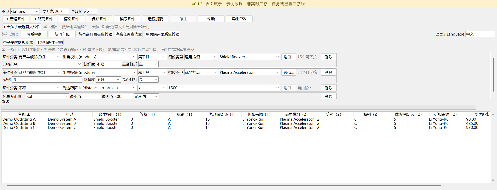
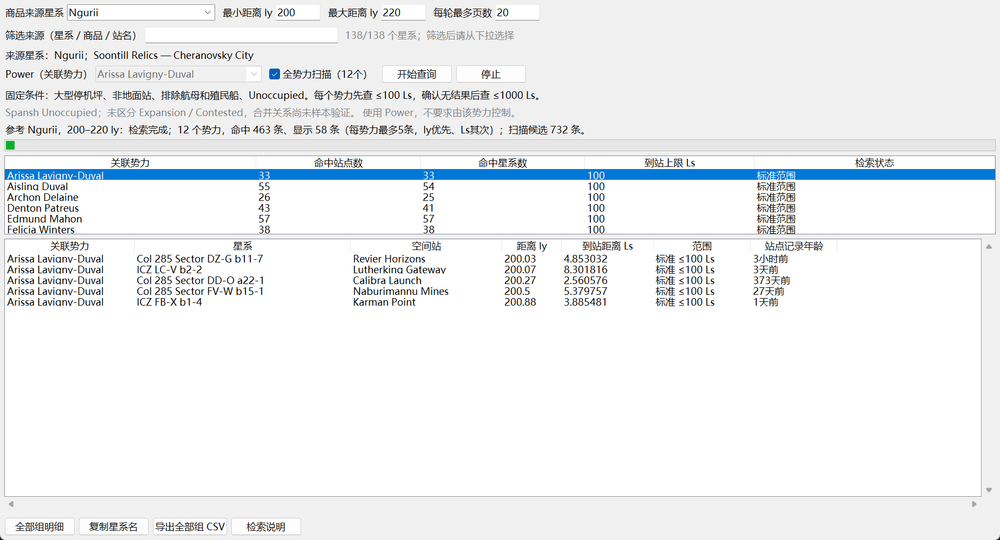
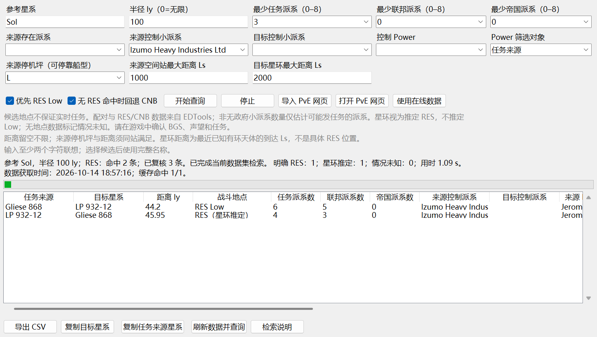
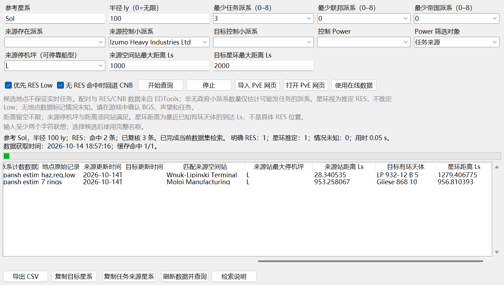
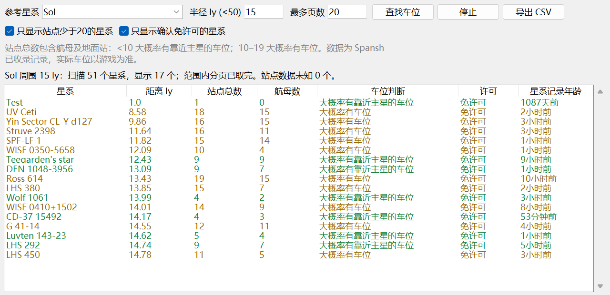
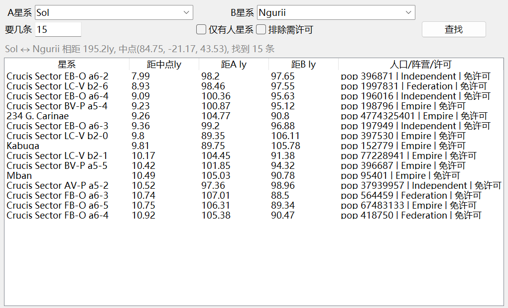

# Elite_dangerous_Filter

[English](README.md) · [简体中文](README_zh-CN.md) · [发行版本 / Releases](https://github.com/kxdxzr/Elite_dangerous_Filter/releases)

[详细检索逻辑与工具规则](README_检索逻辑.md)

基于 [Spansh](https://spansh.co.uk/) 数据的 Elite Dangerous 星系与空间站筛选工具，使用 Python / tkinter，支持即时中英文切换。

**项目定位：不一定比 Inara 更好用，但提供更全面、更灵活、可自由组合的筛选条件。** 适合作为复杂检索的补充工具。

仓库：[kxdxzr/Elite_dangerous_Filter](https://github.com/kxdxzr/Elite_dangerous_Filter)。项目由 **GPT-6.1 Sol** 通过 **vibe coding** 完成，并根据用户需求持续迭代。

> **v0.1.2：殖民候选星系查找器正式发布；海盗任务查找功能仍在测试中。** 海盗查询提供候选来源／目标，不保证游戏内实时任务、派系数量或 RES 可用性。星环推定 RES 与明确记录会分别标注，请在游戏中核实。

## 下载与启动

[**下载 Windows EXE**](https://github.com/kxdxzr/Elite_dangerous_Filter/releases/download/v0.1.2/EliteDangerousFilter.exe) · [v0.1.2 发布说明](docs/releases/v0.1.2.md) · [所有版本](https://github.com/kxdxzr/Elite_dangerous_Filter/releases)

Windows 64 位单文件程序，双击 `EliteDangerousFilter.exe` 即可使用，无需安装 Python。实际查询需要联网，无需 API key。

从源码运行需要 **Python 3.10+ 和 tkinter**，没有第三方运行依赖：

```sh
git clone https://github.com/kxdxzr/Elite_dangerous_Filter.git
cd Elite_dangerous_Filter
python filter_gui.py
```

可运行 `python -m tkinter` 检查 Tk。Debian / Ubuntu 可先安装 `sudo apt install python3-tk`。

主界面右侧选择 **中文 / English**，即时切换主界面及辅助窗口。游戏中的星系、派系、船和模块名称保持原文；切换语言不会改变查询条件。

## 功能

- **殖民候选星系查找器（v0.1.2 新增）**：强制零人口、无站点、无需许可。区域半径与距最近人口达标星系的距离上下限分别可选，星系价值也可选；支持星球与独立星环条件组（全部／任一存在）、卫星关系和互绕成员推定。详见 [v0.1.2 发布说明](docs/releases/v0.1.2.md)。
- **v0.1.2 主界面扩展**：星系普通行新增站点／航母／派系数量；通过 **天体／最近有人条件** 添加嵌套星球／星环组及带可编辑人口门槛的最近距离范围。与普通条件组合，不附带殖民限制；详见 [详细规则](README_检索逻辑.md)。
- **通用筛选**：星系／空间站查询，重复条件组合；同一行多选为 OR，不同行为 AND。
- **距离与模块**：多参考点距离交集／范围外查询，同件模块等级／级别匹配，以及船厂／改装数据新鲜度条件。
- **航母车位查找**：最多 50 ly，按 Spansh 已收录的航母站点类型直接计数来筛选停车候选星系，支持含边界的最少／最多航母数量筛选，类型数据不完整显示未知；数量不代表实时空位。
- **稀有商品目标查找**：142 个来源条目、138 个星系，默认 Ngurii，目标范围默认 200–220 ly。指定关联 Power 或扫描全 12 个势力，要求大型坪，排除地面站、航母、殖民船；各势力先查 ≤100 Ls，完整检索无结果后才放宽到 ≤1000 Ls，按 ly、Ls 排序各显示前 5 站。
- **海盗任务候选查找（测试中）**：EDTools 配对与地点记录，叠加 Spansh 小派系、数量、控制 Power、来源站与目标星环距离条件。
- **辅助操作**：两系中点、停止、检索诊断、CSV 导出、条件保存／加载，以及主界面和五个辅助工具的会话恢复。

## 海盗任务查找（测试中）

打开 **额外功能 → 海盗任务查找器**。所有启用条件都为 AND：

| 条件 | 规则 |
| --- | --- |
| 参考星系／半径 ly | 限制**任务来源到参考点**的距离，不是来源到目标距离；`0` 为不限距离，参考点仍用于排序 |
| 最少任务／联邦／帝国派系 | 独立最少数量条件，均为 `0–8`；`0` 不限制，非零时估计 Spansh 非 Anarchy 潜在任务派系 |
| 来源存在派系 | 来源有指定派系，不要求该派系控制来源 |
| 来源／目标控制小派系 | 完整名称精确匹配，不区分大小写；名称联想不自动改写输入 |
| 控制 Power | 使用 `controlling_power`，可作用于来源、目标或双方；不是关联 `power` |
| 来源停机坪 | 留空不限，S／M／L 为船型需求；大坪兼容小船 |
| 来源空间站最大距离 Ls | 留空不限；与停机坪条件必须由**同一座有 Missions 服务的站点**满足，包含地面站，排除航母／Stronghold Carrier／殖民船 |
| 目标星环最大距离 Ls | 留空不限；最近已知有环天体的到达距离，不是环半径或具体 RES 位置 |
| 优先 RES Low | 明确 Low 优先，不强制要求 Low，也不凭星环臆造 Low |
| CNB 回退 | 完整检索后，没有符合条件的明确／推定 RES，也没有地点未知候选，才显示 CNB；错误或停止时不回退 |

**注意距离单位：** 半径 `0` 为不限；站点／星环距离留空才不限，填 `0` 表示上限为 **0 Ls**，上限包含边界。

- 有环标为 **RES（星环推定）**；无地点资料标为 **情况未知**，不把未知当作没有 RES。启用距离条件后，无法确认距离的记录不计为符合条件，并显示未知／未完成诊断。
- ≤250 ly 使用 EDTools 的明确 `/pve.php` 网页；半径 `0` 或 >250 ly 使用公开 `pve.json`、`res.json` 并按坐标计算距离。完整仅指已收录数据集，不是整个银河；页面参考点、范围、表结构和行数均校验。
- **导入 PvE 网页** 可使用浏览器保存的 HTML；导入范围不足会拒绝。仅地点／半径条件且参考名一致时可离线，其余条件按需访问 Spansh。
- **复制任务来源星系** 与 **复制目标星系** 分别复制选中行；双击仍复制目标。来源站及星环字段包含在结果和 CSV 中。
- 控制派系与 Power 批量预筛、详情复用；Power 使用 gzip 和最多 4 页并发。完整天体数据批量查询星环，避免用不含星环的摘要判定无环。进度节流、每批 200 行绘表，不截断实际结果。
- EDTools 缓存 1 小时，Spansh 详情／控制列表／星环距离缓存 5 分钟。**刷新数据并查询** 切换在线并强制刷新所需数据；失败不静默使用过期缓存。目标 Power 叠加来源条件时仍可能需要补查来源详情。

本机实测 `Sol / 无限 / 最少派系 3 / Yuri Grom / 来源`：强制刷新约 15.37 秒，紧接着缓存复查约 0.19 秒，结果一致。网络及数据变化会影响耗时，不能作为固定性能保证。完整规则和案例见 [检索逻辑](README_检索逻辑.md)。

## 会话、数据与限制

- 每 1.5 秒自动保存变更，关闭窗口时保存；兼容旧会话，保留未填完的主条件草稿、语言和五个工具参数。原子写入，关闭时保存失败会提示并保留窗口。
- EXE 数据目录为 `%LOCALAPPDATA%\EliteDangerousFilter\`；源码默认使用项目目录，可通过 `ELITE_FILTER_DATA_DIR` 覆盖。`last_session.json`、候选／规格缓存、`pve_cache_*.json` 和导出的 CSV 均不上传仓库。
- 数据不是实时任务、库存或空位。派系数量只估计潜在任务发布者，需要游戏内确认 BGS、声望和任务。
- 稀有商品工具使用关联 Power，暂以 Spansh `Unoccupied` 作为 Inara Unoccupied / Expansion / Contested 的合并候选；对应关系尚未样本验证，不能分别筛选后两者。
- 分页计数可能封顶；达到上限、重复页、缺关键数据、请求失败或停止时，明确区分未完成与无结果。

## 开发与验证

```sh
python -m unittest discover -v
python -m compileall -q .
python -m pip install -r requirements-build.txt
python -m PyInstaller --noconfirm --clean EliteDangerousFilter.spec
```

自动化测试覆盖引擎、会话、本地化、PvE 与殖民条件／数据完整性／缓存／并发及真实 GUI 操作。Tk 测试需要图形环境；Linux 无 DISPLAY 时跳过 GUI 测试。GitHub Actions 测试 Windows / Ubuntu、Python 3.10 / 3.13。

构建输出 `dist/EliteDangerousFilter.exe`。隔离目录中使用 `--smoke-test <报告.json>` 验证五个工具窗口和中英文加载；分别运行 `--session-test write <报告.json>` 与 `--session-test read <另一报告.json>` 验证跨进程恢复。会话测试必须设置独立 `ELITE_FILTER_DATA_DIR`；报告目录须存在。

CLI 示例：`python spansh_filter.py --help`；参数说明见 [筛选器说明](README_筛选器说明.txt)。主要模块：`filter_gui.py` / `filter_engine.py`、`powerplay_gui.py` / `powerplay_tool.py`、`pve_gui.py` / `pve_tool.py`、`pve_access.py` / `pve_cache.py`、`i18n.py` / `localized_tk.py`、`faction_options.py`。

## 截图

以下中文界面截图为 v0.1.1 主界面及原有四个辅助工具，拍摄于 2026-10-14，尚未展示 v0.1.2 新增殖民工具及更新的航母筛选；具体记录会随上游数据变化。英文界面截图见 [英文 README](README.md#screenshots)，所有工具均支持通过主界面的语言选择即时切换为英文。

### 主界面



### 稀有商品目标查找器



### 海盗任务查找器——中文，测试中

展示来源派系、任务派系数量、停机坪与站点／星环距离筛选、RES Low 优先，以及分别复制来源／目标的按钮。



### 海盗任务查找器——站点及星环距离明细，测试中

同一查询的表格向右滚动，展示匹配来源站、停机坪、站点到达距离及目标有环天体／距离，适当拉宽列以便阅读。



### 航母车位查找器

v0.1.1 历史截图：Sol 周围 15 ly 的站点／航母统计及旧版车位估计。v0.1.2 保留工具名称，改用航母数量范围筛选；两个版本均不提供实时空位。



### 两系中点工具

查找 Sol 与 Ngurii 中点附近的已收录星系，分别展示距中点、距两端的距离。



## 数据来源

- [Spansh](https://spansh.co.uk/)：星系、站点、派系及完整天体数据。
- [EDSM](https://www.edsm.net/)：参考星系坐标。
- [EDTools / CMDR VicTic](https://edtools.cc/pve.php)：配对与明确 RES/CNB 地点记录，非实时任务 API。
- [Inara](https://inara.cz/elite/)：稀有商品目标模板参考。

社区项目，与 Frontier Developments 无隶属关系。
